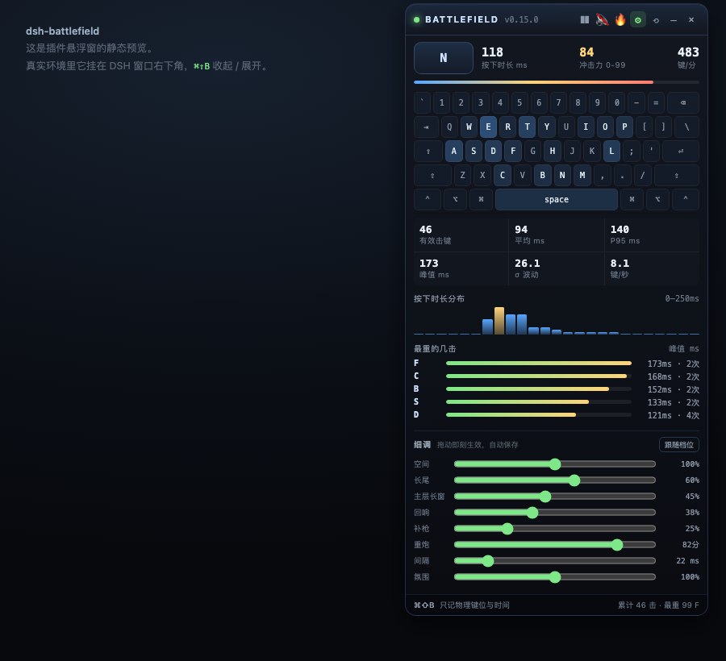
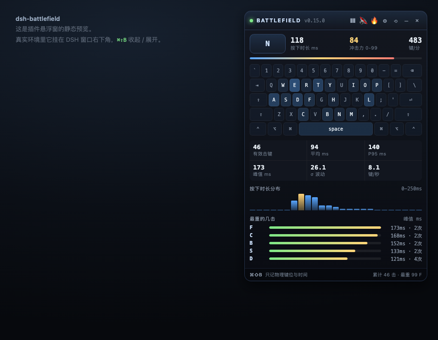
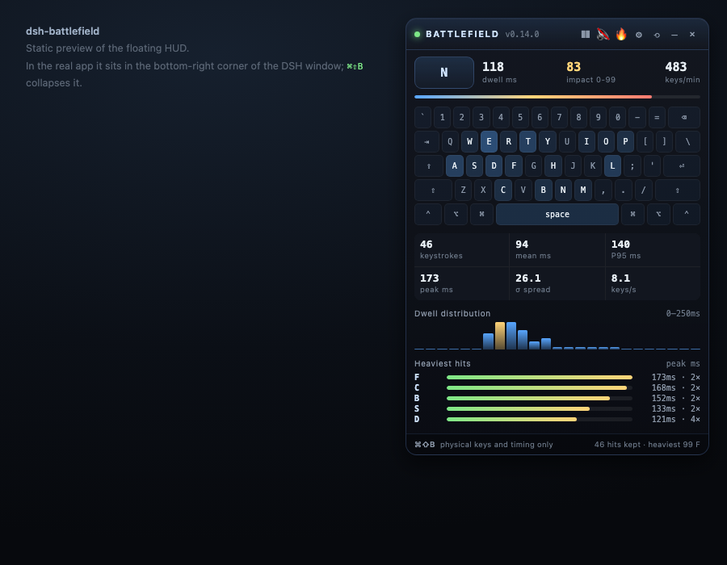

# dsh-battlefield

悬浮在 DeepSeek Harness 窗口里的一块「键盘战场」HUD：实时显示你正在敲哪颗键、按了多久、这一下有多重、当前手速和键位热力图，并且让每一下击键都变成一声炮响——底下还铺着一层永不间断的战场背景音。





**English:** a floating "keyboard battlefield" HUD for [DeepSeek Harness](https://github.com/deepseek-ai). It measures **dwell time** per key (there is no pressure sensor on a laptop keyboard), turns it into a 1–99 impact score, paints a live key heatmap, and plays a cannon shot whose weight follows that score — over a continuous battlefield ambience bed. The HUD switches between Chinese and English automatically with DSH's own language setting. Nothing leaves your machine: no keystroke content, no network, no telemetry.

## 先说清楚：它测的不是「力度」

MacBook 的内置键盘是剪式结构 + 二值开关：HID 描述符里每颗键只有 `按下 / 抬起` 两个状态，**物理上就没有压力值**。所以本插件测的是**按下时长（dwell time）**——从 `keydown` 到 `keyup` 的毫秒数——再把它和「你自己这颗键的历史分布」比较，换算成一个 1–99 的**冲击力**分数。

- 同一个 100ms，敲 `A` 和敲 `空格` 的含义完全不同 → 所以评分优先用**这颗键自己的**历史均值/标准差，样本不足 4 次才退回全局分布。
- 所以它是**相对分数**，不是牛顿。第一次敲某颗键会得到中间值 50，敲得越多越准。
- 想拿真实的每键行程量（0–255），需要模拟量键盘（Wooting 60HE / Razer Huntsman V2 Analog / Apex Pro 等），本插件不适用于那类硬件。

## 它有多费电

几乎不费。刷新循环是**按需**的：

- 不打字时**一个定时器都不存在**——`setInterval` 只在第一次 keydown 时创建，最后一次按键后 1.5 秒自动 `clearInterval`。
- 面板收成小胶囊、窗口切到后台、或者点了暂停，定时器同时清掉。
- 打字时每 120ms 刷一次，实测 `tick = 0.0070ms`、整盘重算 `refreshBoard = 0.0066ms`，按 400 键/分钟算是**单核 0.01%**。
- DOM 写入做了去抖：文本、属性、直方图高度、键位底色都先比对上一次的值，没变就不碰 DOM。主链上也没有 `backdrop-filter`（每帧重算高斯模糊是隐藏的电老虎，已移除）。
- 不写磁盘、不发网络（唯一一次请求是启动时的同源 `GET /mount`，见「隐私」）；累计击键每 10 击才落一次 `localStorage`。

实测（macOS，2 秒粒度采样）：插件满载待机时——47 段样本解码完成、氛围床正在放一段 54 秒的空袭警报、面板开着——**DSH 渲染进程 0.3–0.4%、GPU 进程 0.2%、主进程 0.0%**。

## 隐私

**这是本插件最重要的一节。**

- 只读取 `event.code`（物理键位，如 `KeyA` / `Space`）和 `event.timeStamp`。
- **从不读取 `event.key`、`event.charCode`、输入框内容、剪贴板。** 因此它能知道你按了「左边第三颗字母键」，但拿不到那个字母，更拼不出你打了什么。
- **不上报任何东西。** 没有遥测、没有账号、没有服务端。枪声样本以 base64 内联在客户端 bundle 里，取样本这一步也不走网络。
- 唯一一次网络请求：启动成功后同源 `GET /api/dsh-battlefield/mount`（[client.js:3055](./client.js)），**不带任何数据**，只是给宿主计数一次「客户端真的挂上了」——因为客户端模块加载失败是静默的，没有它就无法从外部确认。可以按需删掉这一段，功能不受影响。
- 数据只存在本机 `localStorage`，共 5 个 key：

  | key | 内容 |
  |---|---|
  | `dsh-battlefield.geometry.v1` | 面板位置、收起/隐藏状态 |
  | `dsh-battlefield.lifetime.v1` | 累计击键数、历史最重一击 |
  | `dsh-battlefield.sfx.v1` | 枪声开关、音量、火力档位 |
  | `dsh-battlefield.sfxdiag.v1` | 音频自检快照（最近一次状态，供排查无声问题） |
  | `dsh-battlefield.mount.v1` | 版本号与挂载时间 |

  清空站点数据即全部消失。
- 事件监听用 `capture: true` 只为在输入框抢到事件之前拿到，但**既不 `preventDefault` 也不 `stopPropagation`**，不影响你正常打字。
- **默认静音**：不点 `🔊` 就不会发出任何声音（浏览器也要求先有一次用户手势）——装上看不到、也听不到，直到你主动开。
- 宿主侧的 `/api/dsh-battlefield/health`、`/mount` **只接受本机回环地址**，并拒绝 `Sec-Fetch-Site: cross-site` 和跨来源请求；返回内容只有版本号、运行时长与计数，没有任何按键数据。它存在的唯一理由是「客户端模块加载失败是静默的」，需要一条能从外部确认的旁证。
- **一个诚实的提醒**：面板会把「你刚按下哪颗键」实时画在屏幕上。共享屏幕、录屏、直播时别人能看见你的键位节奏（但看不到字符，因为字符在输入法/输入框层面）。介意就把面板收起成小胶囊，或直接 `×` 隐藏。

## 交互

| 操作 | 效果 |
|---|---|
| `⌘⇧B` / `Ctrl⇧B` | 收起 / 展开悬浮窗（收起后角落留一个小胶囊，点它回来） |
| 拖动标题栏 | 移动面板，位置记住 |
| 双击标题栏 | 折叠主体，只留标题 |
| `❚❚` / `▶` | 暂停 / 继续采集（暂停时不再计数，也不清历史，同时静音） |
| `↺` | 清零本次统计（累计击键保留） |
| `🔇` / `🔊` | 开启 / 关闭全部音效。开启后出现音量条 |
| `🔥` | 火力档位：标准 → 激烈 → 失控 循环，切换时立刻放一枪让你听差别 |
| `⚙` | 展开细调区：8 个滑块（空间 / 长尾 / 主层长窗 / 回响 / 补枪 / 重炮 / 间隔 / 氛围） |

面板内容从上到下：

1. **当前键 + 按下时长**：按住不放时长会实时往上走。
2. **冲击力 0–99**：本次击键相对历史的重度。
3. **键/分**：滚动 10 秒窗口的估算速度。
4. **六格统计**：有效击键、平均按下时长、P95、峰值、标准差、键每秒。
5. **时长直方图**：25 个桶，每桶 10ms，看你的力度分布形状。
6. **最重的几击**：按峰值时长排序的前 5 颗键。
7. **底部**：本次会话累计 + 历史累计 + 历史最重一击。
8. **枪声行**（开启后出现）：音量 0–100%（默认 35%）+ 当前音频状态字样（就绪 / 待唤醒 / 解码中 / 解码失败）。

## 界面语言

面板跟着 **DSH 的语言设置**走，不用手工切：

- DSH 是中文 → 面板全中文；
- DSH 是英文（或其它任何语言）→ 面板全英文。

用的是宿主的 `ctx.locale` 服务：启动时读一次 `getLocale().active`，之后 `subscribe()` 着，在设置里改语言的一瞬间就换。中文以外的语言统一走英文文案 —— 宁可让德国人看懂英文，也不要留一屏看不懂的中文。

切换语言时**重建整个面板**（`engine` / `sfx` 是同一个对象），所以累计击键、历史最重、当前档位、细调值都不会丢，面板位置也不变。

> 只有中文和英文两套文案。要加日语/俄语，在 `client.js` 的 `I18N` 里加一列、并在 `normalizeLang()` 里放行对应语言码即可。

| 中文 | English |
|---|---|
|  |  |

## 战场音效

敲一下就响一下，**越重越像炮击而不是放鞭炮**。

回车是唯一的例外：按 `Enter`（含小键盘）只放一声「roger that」电台应答，不叠炮击、不回响，也**不做音高抖动**（变调会把语音听成机器音）。它是「确认发送」，不是开火。

人声还有一处必须和枪声不同：枪声用「整段指数衰减」把尾巴收干净，人声用**平顶包络**——保持音量到最后一个字，再 30ms 淡出。早期版本套了枪声的衰减，后半句一路掉到 −30dB，听起来像只读了半句。

### 键盘样本：26 段短切 + 10 段长窗 + 7 段长尾 + 1 段人声

全部切自真实录音（48kHz / 立体声 / Vorbis q6），**不是合成音**：

| 池 | 数量 | 来源 | 用途 |
|---|---|---|---|
| `blast` | 6 | `cannon_hit.ogg`（连续齐射，每 121ms 一响，取前 6 响） | 炮击命中的闷响，主层主力 |
| `wall` | 5 | `cannon_hit_wall.ogg`（3）+ `cannon_hit_wall_no_splash.ogg`（2） | 打在船壳上的钝击 |
| `miss` | 3 | `cannon_miss.ogg`（低通 1.4kHz） | 远处掠过，轻击也用它 |
| `ram` | 4 | `ship_ram_ship_shortened.ogg`（2）+ `ship_ram_ship.ogg`（2） | 撞船的木裂声 |
| `heavy` | 4 | `cannon_fire.ogg`（2，低通 600Hz）+ `ship_destroyed_short.ogg`（2，低通 500Hz） | 重击的低频层与沉船闷响 |
| `far` | 4 | `explosion_somewhere_far.mp3`（2）+ `cannon_hit_ship_short.ogg`（2，低通 1.2kHz） | 持续交火时的远景爆炸 |
| `boom` | 7 | 每个源文件里**唯一那段「后面没有下一发」的干净尾巴**（`cannon_fire` 378ms、`cannon_hit` 2.72s、`ship_destroyed_short` 5.06s、`explosion_somewhere_far` 1.65s、`ship_ram_ship` 4.19s、`ship_ram_ship_shortened` 2.52s、`cannon_hit_ship_short` 1.37s，低通 1.2–2.4kHz） | **长尾层**：1.25–1.90 秒的低频「轰」 |
| `long` | 10 | 每个源里**「后面没有下一发」那一段**的前 0.5–0.6 秒（保留原始 48kHz 立体声、不加低通） | **主层长窗**：按概率顶替短切片的主层，抹掉「啪」的拍手感 |
| `roger` | 1 | `roger_that.mp3`（260Hz 高通 + 3.8kHz 低通做电台味） | **回车专用**：一声「roger that」，不是开火 |

26 段键盘样本合计 **400,699 字节**，每段 0.24–1.2 秒，按峰值 −1dBFS（0.89）归一，4ms 淡入 + 70–250ms 淡出（按池长短不同），所以连打不会因为尾巴太长而糊在一起。`roger-1.ogg` 单独 8223 字节 / 0.885 秒（源就是单声道人声，不做立体声）。

**为什么单发只有 0.3 秒，却不像鞭炮。** 单发切片本来就短 —— 它只是扳机响的那一下。真正的"炮"在**之后那一秒里**，由两件事补出来：

1. **长尾层 `boom`**（7 段 / 208,389 字节 / 1.25–1.90 秒）：每一次按键按档位概率（标准 **45%** / 激烈 **60%** / 失控 **75%**）垫一层低频轰鸣，增益随力度抬升，音高**刻意稳住**（`jitter` 只有 5%，变调会让"轰"变成"咚"）。连打时这些尾巴自然叠成持续的低频底噪，而不是一串独立的"啪"。
2. **共享混响总线**：所有声部统一送进一个 `ConvolverNode`，脉冲响应是**程序生成**的 1.15 秒、指数衰减 2.2 的立体声噪声（不打包真实 IR —— 那要 440KB）。干湿比 0.92 / 0.5，送出量 0.3。这样 240ms 的单发也有 1 秒多的房间尾巴，而且每个声部落在**同一个空间**里，不会各响各的。

为什么不直接把切片拉长：`cannon_hit.ogg` 是每 121ms 一响的连续齐射录音，窗口一长就把后面几发卷进来，听感变成"机枪"而不是"炮"。

主层按力度加权挑选（`pickKind`）：

| 冲击力 | 主层分布 |
|---|---|
| < 46 | 45% 钝击 / 30% 掠过 / 25% 炮击 —— 轻敲偏「远、短」 |
| 46–71 | 50% 炮击 / 30% 钝击 / 12% 撞船 / 8% 掠过 |
| ≥ 72 | 45% 炮击 / 20% 撞船 / 20% 钝击 / 其余炮击+撞船 —— 重敲偏「闷、厚」 |
| 任何力度 | 另有 12% 概率直接换成远处的掠过/撞船声 |

再叠三层随机：播放速率 ±5%（音高不同）、低通（远近不同）、声像 ±0.35（左右不同）——所以连着敲不会听到同一个声音。打到 5 键/秒以上时，还会按概率补远处回响、连发补枪，以及远景爆炸（`far` 层）。

### 火力三档

标题栏的 `🔥` 切换，点了也会立刻放一枪让你听差别（循环：标准 → 激烈 → 失控 → 标准），档位存在 `dsh-battlefield.sfx.v1` 里。

| | 重炮阈值 | 重炮并发 | 远景间隔 | 回响概率 | 补枪概率 | master |
|---|---|---|---|---|---|---|
| 标准 | ≥ 92 | 2 | 2.0–4.6s | 22% | — | 2.0 |
| **激烈（默认）** | ≥ 82 | 3 | 1.3–3.0s | 38% | 25% | 2.6 |
| 失控 | ≥ 72 | 4 | 0.8–2.0s | 55% | 45% | 3.2 |

「补枪」是快打时再来一发 35–80ms 后的第二枪（增益约 0.42–0.82、声像偏一侧），听感上像旁边还有个射手。

### 为什么是软削波而不是压缩器

所有声部先汇到一条主链：`各声部 → master → ÷4 → 软削波 → 输出`。

一开始我上的是 `DynamicsCompressor`（−20dB / ratio 10），结果**实测反而更轻**：

| 主链 | 单发 peak / RMS | 12 发叠加 peak / RMS |
|---|---|---|
| master 1.0，直连（原状） | 0.855 / −23.8dB | **1.031（削波）** / −15.1dB |
| master 1.28 + 压缩 −20dB/10 | — / — | 0.894 / −18.1dB（比原状还轻 2.3dB） |
| master 2.0 + 软削波 0.90 | 0.861 / −19.9dB | 0.880 / −11.4dB |
| master 2.6 + 软削波 0.90 | ~0.87 / −19.4dB | 0.891 / −10.5dB |
| master 3.2 + 软削波 0.90 | ~0.90 / −18.2dB | 0.898 / −9.4dB |

压缩器 attack 太快，把"枪声的冲击力"所在的瞬态直接抹平，自动补偿又补不回来；而原状 master 1.0 在连打时其实已经在削波（峰值 1.031）。

现在改成渐近软削波 `y = k·tanh(RANGE·x/k)`（`k = 0.90` 是峰值天花板，`RANGE = 4` 把信号压进 WaveShaper 只认的 ±1 定义域）：单发响 4–6.5dB、连打峰值被钉在 0.90 不再削波，多出来的那点谐波在听感上就是"更凶"。

两个坑记一下：① `oversample = '4x'` 的上/下采样滤波器会振铃，实测把 12 发峰值从 0.88 顶到 **1.078**（反而削波），所以用 `'none'`；② WaveShaper 的曲线只覆盖 ±1，输入超出就钉在端点（等于硬削波），必须自己先缩放。

### 两层「战场厚度」

单发再脆，也只有「一下」。所以又加了两层，都是叠在单发之下的：

| 层 | 什么时候出 | 怎么出声 |
|---|---|---|
| **重炮层** `heavy` | 冲击力 ≥ 90（按档位 92/82/72），且同时最多 2–4 个 | 0.9s 的炮击轰鸣 / 沉船闷响，播放速率 0.62–0.72、低通 520–780Hz、增益 0.30+、声像 ±0.22 —— 只留低频，像隔着胸腔震一下 |
| **远景层** `far` | 手速 ≥ 3 键/秒时排一发，1.8–4.2s 后响 | 远处爆炸 / 远处中弹，速率 0.85–1.0、低通 900–1800Hz、增益 0.15–0.23、声像 ±0.8（远到听不出方向） |

远景层**不会自动续命**：只有你继续打字、手速过 3 键/秒时，才会在下一次击键时重新排一发。所以停手 6 秒以上就是安静，不会自己在那儿轰。【省电】它只是一个单发 `setTimeout`，不是循环定时器。

### 为什么不直接播原始录音

会有人问：既然素材是我们的，为什么不把 `cannon_hit.ogg` 原样内联、播放时随便取一段？三个理由都能量化：

| 问题 | 实测 | 后果 |
|---|---|---|
| 一按就是**连续齐射** | `cannon_hit.ogg` 4.94 秒里有 **21 响**、间隔 121ms；`ship_destroyed_short.ogg` 11.32 秒里有 **38 响** | 按一下键响五秒，不像开枪像打整场仗 |
| **起振前有静音** | `ship_destroyed_short` 前面 244ms 是安静、`ship_ram_ship` 118ms、`explosion_somewhere_far` 65ms | 打字会「拖半拍」，手感全没了 |
| **峰值差 8 倍** | `wind woosh` 峰值 0.137，`ship_ram_ship` 1.013（已削波） | 同样的音量滑块下，有的听不见有的炸耳朵 |
| **体积** | 10 个源文件共 2,867,075 字节；整段内联 base64 → `client.js` 从 1.5MB 涨到 **5.16MB** | 插件市场装一次要下 5MB，且 ogg 不可压缩 |

所以做法是：**切，但按「一发一窗」切，窗口长度由源决定**——每段只取到「下一发响之前」，长尾层再单独取每个源里唯一那段「后面没有下一发」的干净尾巴（1.25–1.90 秒）。这样既能听见真实的房间尾巴，又不会把下一发卷进来。

### 主层长窗：把「啪」换成「轰」

短切的 0.24–0.32 秒单发有个副作用：它把炮声最有辨识度的**起振后衰减**剪掉了，只剩一个尖头，听感更接近拍手。主层长窗（`long` 池，10 段 0.5–0.6 秒）就是给这件事准备的：它们的窗口都取自每个源里**后面没有下一发**的那一段，所以既能听见衰减，又不会把下一发卷进来。

代价是同质化：一个源只贡献一段长窗，所以长窗池里没有「同一门炮的连续三发」那种变化。因此它是**滑块**而不是默认全量——面板上「主层长窗」默认跟随档位（标准 25% / 激烈 45% / 失控 65%），拉到 0 就完全回到短切，拉到 100 每一下都是长窗，你可以自己听哪一档最像。

实测（5 下按键，同一套键盘事件）：长窗 0% 时每下平均 **0.75 秒**音频，长窗 100% 时每下平均 **2.28 秒**（最短的一段也有 0.55 秒）。

### 氛围层：三条长录音，整段连播（不截断）

键盘声再密，也只是"有很多人在开枪"。真正让耳朵相信这是战场的，是**背景里那些不属于你的事**：远处的空袭警报、从头顶飞过去的轰炸机、偶尔漏出来的电台通话。

这三条都是**原始录音，整段播完**，不截窗口、不切碎。播放顺序是固定的循环：**警报 → B-25 掠过 → 电台 → 警报……**，每段之间只留 2.5–3.5 秒换气。第一次真正按键就起，之后一直在，直到你静音、暂停、收起窗口或关掉枪声。

| 池 | 来源 | 时长 | 编码 | 播放增益 |
|---|---|---|---|---|
| `siren` | `160888__blaukreuz__air-raid.wav` | 54.06s | mono 16kHz q1，174,860B | 0.55 |
| `plane` | `329616__loveburd__b-25-takeoff-01.wav` | 25.37s | mono 16kHz q1，77,494B | 0.50 |
| `radio` | `855900__qubodup__military-air-strike-radio-chatter.ogg` | 54.53s | mono 24kHz q2 + 280–3400Hz 带通，241,238B | 0.38 |

三条合计 **493,592 字节（约 482KB）**。加上 26 段短切、10 段长窗、7 段长尾、roger 与三条氛围录音，`sfx/` 共 **47 段 / 1,275,392 字节（1,246KB）**，内联进 `client.js` 后该文件 **1,828,222 字节（约 1.8MB）**。

几条踩过的坑，都写在代码注释里：

- **音量**。第一版氛围层增益只有 0.08–0.16，而枪声单发增益接近 1.0 —— 等于在炮声底下放蚊子叫，实测根本听不见。现在是 0.38–0.55。
- **不能 suspend**。`scheduleSuspend()` 会在停手 2.5 秒后把 `AudioContext` 挂起，用来省电；但一条 54 秒的警报会在 2.5 秒时被切断。所以只要氛围床在放，就不许挂起。
- **不能查 `document.visibilityState`**。宿主窗口有时会被判成 `hidden`，那样整张床永远不响（枪声踩过同一个坑）。切后台由 `visibilitychange` → `setMuted(true)` 来停，不重复判断。
- **静音 / 暂停 / 收起 / 关掉枪声**都会 `stopBed()`，同时清掉换气定时器，不留一个空转 timer。
- **启动时不解码**，三条长录音在启用枪声后由 `warmAmbience()` 在后台解掉（约 482KB，一次性）。不预热的话，第一次起氛围床会撞上"还没解码"。
- **氛围声部不会被枪声挤掉**。快打时并发上限会触发淘汰，但只淘汰键盘声部（`voice.bed !== true`），否则 54 秒的警报会被当成"最早的一发"淡出。

氛围层的声部和键盘声共用同一个并发上限（18/21/24），超了会先把最早的键盘声部做 14ms 线性淡出再停（直接 `stop()` 会"咔"一下）。

### 面板里的细调

> 悬停任意旋钮名 / 滑块会弹出说明（0.13.0 起，`#dbf-tip`，键盘 `Tab` 聚焦滑块同样会弹），不用去翻代码。（⚙）

标题栏的 **⚙** 打开「细调」，七个滑块，拖动即刻生效、自动存进 `localStorage`（`dsh-battlefield.tune.v1`）：

| 滑块 | 范围 | 默认（跟随档位） | 管什么 |
|---|---|---|---|
| 空间 | 0–200% | 100% | 混响量。**0 = 完全干声**，只留长尾层 |
| 长尾 | 0–100% | 45 / 60 / 75% | 长尾层出现概率（越高越像持续炮战） |
| 主层长窗 | 0–100% | 25 / 45 / 65% | 主层改用 0.5–0.6 秒长样本的概率。0 = 只有短促单发；100 = 每下都是长窗 |
| 回响 | 0–100% | 22 / 38 / 55% | 第二声回响 —— **"噼啪"感的主要来源**，调 0 最干净 |
| 补枪 | 0–100% | 0 / 25 / 45% | 连发补枪概率（一下变两下） |
| 重炮 | 1–99 分 | 92 / 82 / 72 | 冲击力超过它才叠重炮层，调低 = 更多闷响 |
| 间隔 | 0–150ms | 22ms | 两下相距小于它时不发声，用来稀释过密的连打 |
| 氛围 | 0–200% | 100% | 警报 / 飞机 / 电台的音量 |

没拖过的滑块**跟随当前火力档位**（`🔥` 切档时数值会跟着变、标签是灰色）；拖过的会变绿并写进存储，「跟随档位」按钮把它们全部清掉。

面板开合状态本身也持久化（`geometry.v1.tune`），下次打开还是开着；展开时会自动把窗口顶回视口内，不让最后一行被截掉。

## 素材来源与授权

代码 **MIT**（[LICENSE](./LICENSE)）。声音**全部 CC0（公有领域）**，逐条出处见 [docs/CREDITS.md](./docs/CREDITS.md)：

| 用途 | 原始作品 | 作者 | 授权 |
|---|---|---|---|
| 炮声 / 撞船 / 重炮 / 远景（10 个源文件） | [Battle at sea](https://opengameart.org/content/battle-at-sea) | Thimras | CC0 |
| 远景爆炸 | [Explosion somewhere far](https://opengameart.org/content/explosion-somewhere-far) | pauliuw | CC0 |
| 空袭警报 / B-25 掠过 / 电台通话 | [160888](https://freesound.org/s/160888/) / [329616](https://freesound.org/s/329616/) / [855900](https://freesound.org/s/855900/) | blaukreuz / loveburd / qubodup | CC0 |
| 回车应答「roger that」 | [Voice Male Radio Roger That](https://freesound.org/people/qubodup/sounds/67662/) | qubodup | CC0 |

第一版曾用过 OpenGameArt 的两个 CC0 手枪录音，现已在仓库中全部移除。所有样本都可以用 `tools/build-sfx.py` 从 `sfx/` 一键重建；换素材不会碰代码。

## 安装

**从插件市场装**（推荐，需要 DSH 0.14+）：

在 **插件 → Discover** 里搜 `battlefield`，或者直接装包名：

```bash
dsh plugin add dsh-battlefield
```

**从本地目录装**（开发用）：

```bash
plugin_manager install_bundle /path/to/dsh-battlefield
```

装完 **完全退出并重开 DSH**（不是刷新页面）：bundle 层是 Host 启动时加载的，新装插件不会热加载。

自检宿主侧是否真的加载（端口以 DSH 实际监听为准）：

```bash
curl -s http://127.0.0.1:<port>/api/dsh-battlefield/health
# {"ok":true,"name":"dsh-battlefield","version":"0.15.1","uptimeMs":...,"mounts":0,"lastMountAt":null}
```

这条路由存在的意义：客户端模块**加载失败是静默的**——白屏和「没装」看起来一样。健康接口是唯一能从外部证明「宿主这一行真的跑起来了」的证据；`mounts` 由客户端挂载成功后自报，`lastMountAt` 能看出它什么时候挂上的。该路由**只接受本机回环地址**，并且拒绝 `Sec-Fetch-Site: cross-site` 与跨来源请求；返回的内容只有版本号和计数。

**第一次出声**需要一次用户手势（点 🔊），这是浏览器的自动播放策略，绕不过去。点完状态字应变成「就绪」，敲几下就能听到炮声和底下的警报。**默认是静音**——不点就不会响。

## 卸载 / 临时关掉

- 临时：面板右上角 `×` 隐藏、`⌘⇧B` 收起，或点 `🔊` → 静音（音频线程随之挂起）。
- 彻底：`dsh plugin remove dsh-battlefield`（或插件管理里禁用），然后删掉上表 5 个 `localStorage` key（在 DSH 的设置里清站点数据即可）。

## 包体积

`npm pack` 的结果（`sfx/` 不进包，因为运行时不读它，只作素材源保留）：

```
package size: 1.13 MB      ← 实际下载量
unpacked size: 1.78 MB
total files: 6             index.js / client.js / cordis.patch.yml / icon.svg / README.md / package.json
```

`client.js` 1.83 MB 里约 1.70 MB 是内联音频的 base64（47 段、1,275,392 字节的 ogg）；gzip 后 1.18 MB——base64 能压，`.ogg` 本身压不动。

想再瘦：把 48kHz 降到 32kHz（约 ×0.67），或让三条长氛围改走宿主路由按需读取（可到 ~450KB）——代价是前者损失一点高频、后者失去「改完就热更」的便利。

## 开发

```bash
node --check client.js        # 语法
node test/smoke.mjs           # 假 DOM + 假 Web Audio 冒烟测试（161 项断言，无需浏览器）
open test/preview.html        # 本地看一眼悬浮窗长什么样

# 真浏览器冒烟测试（真 CSS 注入、真 KeyboardEvent、真时间戳）
"/Applications/Google Chrome.app/Contents/MacOS/Google Chrome" \
  --headless=new --disable-gpu --virtual-time-budget=8000 \
  --dump-dom "file://$PWD/test/browser.html" | grep -o 'PROBE-[A-Z-]*'

./push-live.sh                # 把 client.js / index.js / sfx 推到所有正在服务的 generation
```

`push-live.sh` 是日常迭代的正路：`install_bundle` 会生成**新的不可变 generation 目录**再切 symlink，而运行中的 Host 仍在服务旧目录，所以「重新安装 + 刷新页面」看不到变化。直接覆盖所有 generation 里的文件才是幂等且立即生效的（客户端 HMR 每 500ms `stat` 一次 mtime）。**但 `index.js` 的改动仍然要重启**——它是 Host 侧代码。

冒烟测试值得单独说一句：它用一个几十行的假 DOM + 假 `AudioContext` 把 `client.js` 真跑了一遍——`new Function(..., '"use strict";' + src)` 里任何未声明变量都会直接抛，比「肉眼看代码」可靠得多。`test/browser.html` 再补一层真 Chrome、真 `KeyboardEvent`、真时间戳。想验证声音，用 CDP 脚本（`--remote-debugging-port` + `--autoplay-policy=no-user-gesture-required`）：`--dump-dom --virtual-time-budget` 读不到异步解码结果，会永远停在 `PENDING`。

这套测试抓到过的真 bug（每一个都是"看起来没问题却真的坏"）：

- `MODIFIERS` 表里写的是 `1`、判断用的是 `=== true` → 修饰键没被排除，按住 ⌘ 两秒把平均按下时长从 93ms 拉到 245ms。
- `event.timeStamp` 与 `performance.now()` 两个时钟混用 → 「按住多久」算出 15791ms。
- `decodeAudioData` 既走回调又走 Promise → 每个样本解码两次、缓存里存两份。
- 变速播放时包络按 `buffer.duration` 收尾 → 1 秒的炮声 0.75 秒被掐断。
- 合唱团式的"静音残留"：`muted` 是个持久标志，锁屏时置 true，回前台没重置 → 第二天早上完全没声音。
- 并发淘汰把 54 秒的警报当"最早的一发"淡出 → 快打时背景音突然消失。
- 面板收起后 HUD 仍每 120ms 刷一次 → 白烧 CPU，改成按需后静止时零定时器。

## 文件

```
index.js            宿主半边：/health + /mount 两条只读路由
client.js           浏览器半边：采集 + 统计 + 悬浮窗 + 音频（纯 DOM，不依赖 React）
cordis.patch.yml    bundle 层，插入一行 Host patch
icon.svg            插件市场图标
sfx/                47 段素材（不进 npm 包；构建时转成 base64 内联进 client.js）
tools/build-sfx.py  把 sfx/*.ogg 重算进 client.js 的 SFX_LIBRARY / SFX_DATA（幂等）
tools/sfxplay       终端试听 sfx/*.ogg 或任意音频（ffmpeg → wav → afplay）
test/smoke.mjs      假 DOM + 假 Web Audio 冒烟测试（161 项）
test/browser.html   真 Chrome 冒烟测试（19 项）
test/preview.html   静态预览页，docs/preview.png / preview-en.png 由它截出来（加 ?lang=en 出英文）
push-live.sh        热更新推送到所有 generation
LICENSE             代码 MIT
docs/CREDITS.md     47 段声音的逐条出处与授权（CC0）
docs/icon-512.png   市场卡片图标（GitHub 托管的位图）
```

## 已知边界

- 只在 **DSH 窗口有焦点**时采集。系统级全局监听（CGEventTap）需要「输入监控」权限，且会把所有应用的击键都收进来，对这个功能来说越界了。
- 界面只有中文和英文两套文案；DSH 设成日语/法语等时显示英文。
- 中文 / 俄文等输入法组字过程中的按键依然按**物理键位**统计（这正是我们只读 `event.code` 的好处：不受输入法影响）。
- 按住不放只算一次击键（`repeat` 事件被忽略），所以「按住 Delete 删一屏」不会让手速爆表。
- **只在 macOS 上验证过**（14.5 / arm64）。代码没用到平台特有 API，但 Web Audio 的自动播放策略、`AudioContext` 挂起行为在别的系统上需要重测。
- 音效**需要一次用户手势**才能启动（浏览器策略），这是硬限制，不是 bug。
- 打字速度上限：`SFX_MIN_GAP_MS = 22` 以内的第二下完全不发声（防相位叠加糊成一片），所以极限 45 键/秒以上会漏音——人类达不到。
- 冲击力是**相对你自己**的分数，不能跨机器/跨人比较；换键盘也不会自动校准（前 4 下会先给 50）。
- 音效是**外放会吵到同事**的那种；静音开关就在标题栏，`🔊` 一下即可。

## 兼容性

| 项 | 状态 |
|---|---|
| DSH | ≥ 0.14.0（`ctx.locale` 语言服务、`shell.overlay` 浮层槽位） |
| 平台 | **macOS 14.5 / arm64 验证过**；Windows / Linux 未测（代码无平台 API，但 Web Audio 行为需重测） |
| 宿主 | 桌面端与 Web 端都走同一份客户端 bundle；纯 Web 端需要 `webServer` 才会有健康路由（没有也能用） |
| 键盘 | 任何键盘都能用；测的是按下时长，不是压力。模拟量键盘（Wooting / Huntsman Analog / Apex Pro）的行程数据本插件读不到 |

## 版本历史

| 版本 | 变化 |
|---|---|
| 0.15.1 | 健康路由收紧为只允许本机回环；补 LICENSE 与素材授权 |
| 0.15.0 | 主层长窗（第 8 个滑块）：主层可用 0.5–0.6 秒长样本 |
| 0.14.1 | 长尾池 4 → 7 段、1.25–1.90 秒；长尾概率 45 / 60 / 75% |
| 0.14.0 | 中英文自动切换（跟随 DSH 语言设置，切语言重建视图不丢统计） |
| 0.13.0 | 旋钮悬浮说明（鼠标悬停 / Tab 聚焦） |
| 0.12.0 | `⚙` 细调面板：7 个滑块，手调值与「跟随档位」 |
| 0.11.x | 共享混响总线 + 长尾层；混响从 1.15s 收到 0.55s |
| 0.10.0 | 全部 48kHz 立体声重切（修掉 24kHz 单声道的「廉价版」听感） |
| 0.9.x | 连续氛围床（警报 → B-25 → 电台，整段连播）；隔夜空音自愈 |
| 0.8.0 | 三条长录音做氛围层 |
| 0.7.0 | 删掉 pistol / magnum，全部换成用户素材的炮击类音色 |
| 0.6.0 | 用户 ogg 素材入池（blast / wall / miss / ram） |
| 0.1.0–0.5.x | 悬浮窗、dwell 统计、键位热力图、冲击力评分、软削波主链 |
